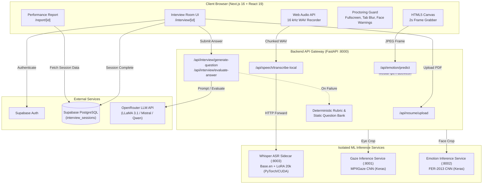

# Research Details & System Specification: PreMock AI (Workspace: MY_PART)

**Project Title:** AI-Powered Video Interview Practice Platform with Automated Performance Evaluation and Personalized Feedback Reports  
**Repository Path:** `D:\project phase 2\final_project-1`  
**Workspace Identifier:** `MY_PART`  
**Date of Audit:** October 13, 2026  
**Auditor:** DeepMind Antigravity Pair Programmer  

---

## 1. PROJECT OVERVIEW

### 1.1 Problem Statement
Technical interview preparation presents significant hurdles for engineering candidates and university students. Traditional mock interviews require human evaluators, which are expensive, scheduling-constrained, and prone to inconsistent subjective assessment. Conversely, text-only interview tools fail to simulate the real-time pressure of video interviews, cannot evaluate non-verbal engagement (gaze/eye contact, emotional presence), and frequently fail to transcribe non-native English accents (particularly Indian English accents) accurately.

### 1.2 Objectives
PreMock AI aims to provide a full-stack, multimodal automated technical interview platform that:
1. Ingests candidate resumes (PDF) and extracts structured qualifications to dynamically anchor interview questions to candidate experience.
2. Generates role- and difficulty-adaptive technical interview questions and follow-up probes.
3. Transcribes spoken answers locally using a custom fine-tuned speech-to-text model optimized for Indian-accented English.
4. Performs real-time visual proctoring and behavioral analysis (face presence, eye contact/gaze direction, facial expression recognition).
5. Computes structured, rubric-based scores (overall, technical depth, communication clarity, relevance) and generates granular feedback reports.

### 1.3 Intended Users
- Job seekers and university engineering students preparing for technical software engineering roles (Full Stack Engineer, Frontend Developer, Backend Engineer, DevOps / SRE).
- Academic career centers and recruitment preparation programs requiring scalable, reproducible interview practice.

### 1.4 Implementation Status Breakdown

| Feature Category | Implementation State | Evidence in Codebase |
| :--- | :--- | :--- |
| **PDF Resume Upload & Text Extraction** | **Completed** | [backend/app/routes/resume.py](file:///d:/project%20phase%202/final_project-1/backend/app/routes/resume.py), [backend/app/services/resume_parser.py](file:///d:/project%20phase%202/final_project-1/backend/app/services/resume_parser.py) |
| **Role & Difficulty Selection** | **Completed** | [frontend/src/app/interview/page.tsx](file:///d:/project%20phase%202/final_project-1/frontend/src/app/interview/page.tsx), [backend/app/services/llm_engine.py](file:///d:/project%20phase%202/final_project-1/backend/app/services/llm_engine.py) |
| **Resume-Based Question Generation** | **Completed** | [backend/app/services/interview_llm_service.py](file:///d:/project%20phase%202/final_project-1/backend/app/services/interview_llm_service.py#L31-L108) |
| **Dynamic Follow-Up Probing** | **Completed** | [backend/app/services/interview_llm_service.py](file:///d:/project%20phase%202/final_project-1/backend/app/services/interview_llm_service.py#L111-L207), [frontend/src/app/interview/[id]/page.tsx:L833-L843](file:///d:/project%20phase%202/final_project-1/frontend/src/app/interview/%5Bid%5D/page.tsx#L833-L843) |
| **Local Speech-to-Text (Whisper LoRA)** | **Completed** | [ml/asr_service/asr_server.py](file:///d:/project%20phase%202/final_project-1/ml/asr_service/asr_server.py), [ml/asr_service/whisper_engine.py](file:///d:/project%20phase%202/final_project-1/ml/asr_service/whisper_engine.py) |
| **Facial Expression Recognition (CNN)** | **Completed** | [backend/emotion_service_server.py](file:///d:/project%20phase%202/final_project-1/backend/emotion_service_server.py), [ml/emotion/train.py](file:///d:/project%20phase%202/final_project-1/ml/emotion/train.py) |
| **Gaze & Eye Contact Estimation** | **Completed** | [backend/gaze_service_server.py](file:///d:/project%20phase%202/final_project-1/backend/gaze_service_server.py), [backend/app/services/gaze_service.py](file:///d:/project%20phase%202/final_project-1/backend/app/services/gaze_service.py) |
| **Face Presence & Multi-Face Detection** | **Completed** | MediaPipe FaceMesh in [backend/app/services/gaze_service.py:L39-L100](file:///d:/project%20phase%202/final_project-1/backend/app/services/gaze_service.py#L39-L100) |
| **Proctoring Violations & Warnings** | **Completed** | Tab switch, fullscreen exit, multi-face, face-away in [frontend/src/app/interview/[id]/page.tsx:L1022-L1072](file:///d:/project%20phase%202/final_project-1/frontend/src/app/interview/%5Bid%5D/page.tsx#L1022-L1072) |
| **Deterministic 100-Mark Rubric** | **Completed** | Word count, tech keywords, comm markers in [backend/app/services/llm_engine.py:L439-L535](file:///d:/project%20phase%202/final_project-1/backend/app/services/llm_engine.py#L439-L535) |
| **Score Aggregation & DB Persistence** | **Completed** | PostgreSQL table `interview_sessions` in [frontend/src/app/interview/[id]/page.tsx:L722-L750](file:///d:/project%20phase%202/final_project-1/frontend/src/app/interview/%5Bid%5D/page.tsx#L722-L750) |
| **Report Viewer Dashboard** | **Completed** | [frontend/src/app/report/[id]/page.tsx](file:///d:/project%20phase%202/final_project-1/frontend/src/app/report/%5Bid%5D/page.tsx) |
| **Real-time Live Audio Streaming** | **Partial** | Sequential chunked WAV upload via HTTP (`/api/speech/transcribe-local`) rather than full duplex WebSocket |
| **Report Timeline Graph** | **Mocked** | Static array in [frontend/src/app/report/[id]/page.tsx:L64-L72](file:///d:/project%20phase%202/final_project-1/frontend/src/app/report/%5Bid%5D/page.tsx#L64-L72) (`[{ time: "0:00", confidence: 60, stress: 45 }, ...]`) |
| **Posture Analysis** | **Absent / Not Implemented** | Zero files, functions, or schemas exist in this workspace (expected in friend's workspace) |
| **Voice / Prosody Analysis** | **Absent / Not Implemented** | Zero acoustic pitch, jitter, speaking rate, or vocal energy models exist (expected in friend's workspace) |

---

## 2. MODULE INVENTORY

### Module 1: Resume Extraction and Job-Role Selection
- **Purpose:** Extracts plain text from candidate resume PDF files, sanitizes control characters and whitespace, and provides job track contexts.
- **Status:** Completed.
- **Method:** Rule-based PDF extraction and regex text sanitization.
- **Inputs:** Binary PDF upload (`multipart/form-data`, max 5 MB).
- **Outputs:** `ResumeUploadResponse`: `{ success: bool, filename: str, page_count: int, text: str, error: Optional[str] }`.
- **Main Files & Functions:**
  - `backend/app/routes/resume.py`: `upload_resume(file: UploadFile)`
  - `backend/app/services/resume_parser.py`: `ResumeParser.extract_text_from_pdf_bytes(pdf_bytes: bytes)`
  - `backend/app/services/resume_service.py`: `clean_resume_text(raw_text: str)`
- **Dependencies:** `PyPDF2>=3.0.1`, Python `re`, `io`.

### Module 2: Interview Question Generation and Dynamic Follow-ups
- **Purpose:** Generates personalized, resume-grounded technical questions and analyzes submitted answers to trigger targeted technical follow-ups.
- **Status:** Completed.
- **Method:** Multi-LLM provider orchestration via OpenRouter API with static curated question bank fallback.
- **Inputs:** Candidate resume text, target job role, selected difficulty ("Easy", "Medium", "Hard"), question text, candidate answer text.
- **Outputs:**
  - Question: `InterviewQuestionResponse`: `{ question: str, question_type: "resume_based", topic: str, source: str }`
  - Evaluation: `AnswerEvaluationResponse`: `{ score: int, relevance: int, technical_depth: int, clarity: int, completeness: int, strengths: list[str], improvements: list[str], evaluation: str, follow_up_needed: bool, follow_up_question: Optional[str] }`
- **Main Files & Functions:**
  - `backend/app/routes/interview.py`: `generate_resume_question()`, `evaluate_resume_answer()`
  - `backend/app/services/interview_llm_service.py`: `OpenRouterLLMService.generate_question()`, `OpenRouterLLMService.evaluate_answer()`
  - `backend/app/services/llm_engine.py`: `LLMEngine.ROLE_QUESTION_BANKS` (60 curated fallback questions across 4 roles)
- **Dependencies:** `openai>=1.50.0` (AsyncOpenAI client configured for OpenRouter `https://openrouter.ai/api/v1`), Pydantic models in `backend/app/models/schemas.py`.

### Module 3: Speech-to-Text (ASR)
- **Purpose:** Transcribes candidate spoken answers locally in real-time, handling Indian English accents and technical jargon.
- **Status:** Completed.
- **Method:** Fine-tuned Low-Rank Adaptation (LoRA) adapter on `openai/whisper-base.en` with 8-bit quantization and runtime glossary biasing.
- **Inputs:** 16 kHz Mono WAV audio file buffer (`multipart/form-data`).
- **Outputs:** JSON: `{ text: str, transcription_time_s: float, audio_duration_s: float }`.
- **Main Files & Functions:**
  - `ml/asr_service/asr_server.py`: FastAPI server running on port 8003 (`POST /transcribe`, `GET /health`)
  - `ml/asr_service/whisper_engine.py`: `WhisperEngine.transcribe()`, `WhisperEngine.build_prompt()`
  - `ml/asr_service/glossary.json`: Technical vocabulary dictionary and phoneme corrections.
  - `backend/app/routes/speech.py`: `transcribe_local(audio: UploadFile, context: Optional[str])`
- **Dependencies:** `torch==2.5.1+cu121`, `transformers==4.46.0`, `peft==0.21.2`, `bitsandbytes==0.50.2`, `soundfile`, `librosa`.

### Module 4: Facial Expression Analysis
- **Purpose:** Classifies facial expressions from webcam video frames into 7 emotion categories every 2 seconds during the interview.
- **Status:** Completed.
- **Method:** Custom Convolutional Neural Network (CNN) trained on FER-2013, evaluated alongside a MobileNetV2 transfer learning model.
- **Inputs:** 48×48 grayscale cropped face image buffer (`multipart/form-data`).
- **Outputs:** JSON: `{ emotion: str, confidence: float }` (classes: angry, disgust, fear, happy, neutral, sad, surprise).
- **Main Files & Functions:**
  - `backend/emotion_service_server.py`: Microservice running on port 8002 (`POST /predict`, `GET /health`)
  - `backend/app/services/emotion_service.py`: `EmotionService.predict_emotion(image_bytes: bytes)`
  - `backend/app/routes/emotion.py`: `predict_emotion(file: UploadFile)`
  - `ml/emotion/train.py`: CNN training script
  - `ml/emotion_v2/train_v2.py`: MobileNetV2 transfer learning script
- **Dependencies:** `tensorflow>=2.15.0`, `opencv-python`, `numpy`, `Pillow`.

### Module 5: Gaze and Eye Contact Estimation
- **Purpose:** Detects face landmarks, calculates eye bounding boxes, estimates 3D head/eye gaze angles (pitch and yaw), and determines eye contact.
- **Status:** Completed.
- **Method:** MediaPipe FaceMesh landmark localization coupled with a custom 3-layer regression CNN trained on MPIIGaze.
- **Inputs:** Raw RGB frame for MediaPipe; cropped right eye grayscale image (48×36) for CNN.
- **Outputs:** `{ face_present: bool, face_count: int, looking_at_camera: bool, gaze_pitch: float, gaze_yaw: float }`.
- **Main Files & Functions:**
  - `backend/gaze_service_server.py`: Microservice running on port 8001 (`POST /predict`, `GET /health`)
  - `backend/app/services/gaze_service.py`: `GazeService.analyze_gaze(image_bytes: bytes)`
  - `ml/eye_contact/train.py`: CNN regression model training
  - `ml/eye_contact/eye_contact_thresholds.json`: Calibrated pitch/yaw thresholds (`center_pitch: -0.1528`, `center_yaw: -0.0726`).
- **Dependencies:** `mediapipe==0.10.14`, `tensorflow>=2.15.0`, `opencv-python`, `numpy`.

### Module 6: Posture Analysis
- **Purpose:** Tracking body posture, slouching, shoulder alignment, or fidgeting.
- **Status:** **Absent / Not Implemented in this workspace.**
- **Method:** Not available.
- **Files:** None. (Delegated to collaborator's workspace).

### Module 7: Voice / Prosody Analysis
- **Purpose:** Analyzing speech pitch variation, speaking rate (WPM), pause duration, energy, or vocal stress.
- **Status:** **Absent / Not Implemented in this workspace.**
- **Method:** Not available.
- **Files:** None. (Delegated to collaborator's workspace).

### Module 8: Answer / Content Scoring
- **Purpose:** Grades individual interview answers on technical depth, completeness, clarity, and relevance.
- **Status:** Completed.
- **Method:** Dual-path scoring:
  1. Primary: LLM structured evaluation via OpenRouter / OpenAI JSON completion.
  2. Fallback: Deterministic 100-mark heuristic algorithm analyzing word count, technical term hits, communication markers, and question overlap.
- **Inputs:** Question string, candidate answer string, target role, difficulty.
- **Outputs:** Scores (0–100) across technical depth, clarity, relevance, completeness, overall score, plus strengths and weaknesses.
- **Main Files & Functions:**
  - `backend/app/services/interview_llm_service.py`: `evaluate_answer()`
  - `backend/app/services/llm_engine.py`: `_score_answer()`, `_rule_based_evaluate()`
- **Dependencies:** OpenRouter AsyncOpenAI client, Python standard library regex.

### Module 9: Score Aggregation
- **Purpose:** Combines per-question scores, proctoring violation counts, and visual attention metrics into interview-level summaries.
- **Status:** Completed.
- **Method:** Mean aggregation across question scores, proportional calculation of face presence and eye contact percentages, and categorical emotion frequency distribution.
- **Inputs:** Array of `AnswerEvaluationResponse` objects, array of boolean gaze frames, array of emotion frames, violation counters.
- **Outputs:** Interview summary payload stored to Supabase table `interview_sessions`.
- **Main Files & Functions:**
  - `frontend/src/app/interview/[id]/page.tsx`: `endInterview()` (lines 607–725)
- **Dependencies:** `@supabase/supabase-js^2.112.3`.

### Module 10: Personalized Feedback and Report Generation
- **Purpose:** Visualizes multi-dimensional performance metrics, skill bars, emotion breakdown, and actionable improvement recommendations.
- **Status:** Completed.
- **Method:** Dynamic Next.js React dashboard querying Supabase session records.
- **Inputs:** `session_id` UUID.
- **Outputs:** Web UI report displaying overall score, skill breakdown, eye contact %, face present %, 7-emotion bar chart, strengths, weaknesses, and per-question reviews.
- **Main Files & Functions:**
  - `frontend/src/app/report/[id]/page.tsx`: `ReportPage` component
  - `backend/scripts/create_interview_sessions_table.sql`: Database schema definition
- **Dependencies:** Next.js 16 App Router, React 19, TailwindCSS 4.

---

## 3. ARCHITECTURE AND INTERVIEW FLOW

### 3.1 Implemented Technology Stack & Versions

- **Frontend:** Next.js `16.3.1`, React `19.2.8`, TypeScript `5.x`, TailwindCSS `4.x`.
- **Backend Server:** FastAPI `0.115.0`, Uvicorn `0.30.6`, Python `3.12.10`, Pydantic `2.9.2`.
- **Database & Auth:** Supabase Auth (Google OAuth & Email/Password), Supabase Storage (PDF resumes), PostgreSQL (table `interview_sessions`).
- **Microservices Architecture:**
  - `localhost:8000`: Main FastAPI Orchestration Gateway (`backend/venv`)
  - `localhost:8001`: Gaze / Eye-Contact Microservice (`backend/gaze_venv`, Keras / TF)
  - `localhost:8002`: Emotion Recognition Microservice (`backend/emotion_venv`, Keras / TF)
  - `localhost:8003`: Local Whisper ASR Microservice (`ml/asr_venv`, PyTorch 2.5.1 + CUDA 12.1)
  - `localhost:3000`: Next.js Web Client

### 3.2 Implemented End-to-End Interview Flow
1. **Setup:** The candidate authenticates via Supabase Auth, uploads a resume PDF, and selects a job role (e.g., Full Stack Engineer) and difficulty (e.g., Medium) with duration (e.g., 30 mins) on `/interview`.
2. **Text Cleaning:** `POST /api/resume/upload` parses the PDF via `PyPDF2`, extracts text, removes control characters, and returns clean text stored in React component state.
3. **Session Initialization:** `POST /api/interview/generate-question` calls OpenRouter to generate the first question grounded in the candidate's actual projects/skills.
4. **Live Proctoring & Vision Loop:** Every 2000 ms, the frontend captures a webcam frame canvas JPEG:
   - Dispatches `POST /api/emotion/predict` to Port 8000.
   - Port 8000 runs MediaPipe FaceMesh to detect faces. If 1 face is found, it crops the face and queries Port 8002 (Emotion CNN); it crops the right eye and queries Port 8001 (Gaze CNN).
   - If face is absent for 2 consecutive cycles (>= 4s), a warning banner appears (`⚠️ Please stay in the camera frame`).
   - If multiple faces are detected, a warning appears (`⚠️ Only one person should be in the frame`).
   - If gaze pitch/yaw exceeds threshold for 2 consecutive cycles, a warning appears (`⚠️ Please look at the camera`).
5. **Speech Recording & Answer Submission:**
   - Candidate clicks mic or types answer.
   - When speaking, browser audio processor encodes Float32 PCM chunks to 16 kHz WAV blobs, uploading sequentially to `POST /api/speech/transcribe-local` (proxied to Port 8003 Whisper engine).
   - Transcribed text merges into the answer text area in real-time.
6. **Answer Evaluation & Dynamic Probing:**
   - Candidate clicks Send. `POST /api/interview/evaluate-answer` evaluates the answer.
   - If `follow_up_needed == True`, the next question is the LLM-generated follow-up question.
   - If `follow_up_needed == False`, `POST /api/interview/generate-question` generates the next resume-based technical question.
7. **Session Termination & Reporting:**
   - On timer expiry (or manual exit), `endInterview()` aggregates mean scores, computes eye contact %, face present %, and emotion frequencies, and inserts the full row into Supabase table `interview_sessions`.
   - The user is redirected to `/report/[id]` to review their evaluation.

### 3.3 Architecture Diagram



---

## 4. MODEL AND DATASET DETAILS

### 4.1 Speech-to-Text Model (ASR)
- **Algorithm / Architecture:** OpenAI Whisper-base.en (encoder-decoder transformer, 39M parameters) fine-tuned using Parameter-Efficient Fine-Tuning (PEFT) LoRA.
- **LoRA Configuration:**
  - Rank ($r$): 8
  - Alpha ($\alpha$): 16
  - Target Modules: `["q_proj", "v_proj"]`
  - Dropout: 0.05
  - Trainable parameters: ~1.18 MB adapter weights (`adapter_model.safetensors`)
- **Quantization:** 8-bit precision (`BitsAndBytesConfig(load_in_8bit=True)`).
- **Source Model:** `openai/whisper-base.en` (Hugging Face Hub).
- **Input Format:** 80-channel log-mel spectrogram (3,000 frames max, 16,000 Hz audio).
- **Output Format:** English token IDs decoded to text string.
- **Dataset:** `ishands/commonvoice-indian_accent` (Mozilla Common Voice Indian English subset).
  - Source URL: `https://huggingface.co/datasets/ishands/commonvoice-indian_accent`
  - License: CC0 / Mozilla Public License (Common Voice derivative).
  - Sample Count: 40,000+ available.
  - Splitting Protocol: Partitioned strictly by speaker `client_id` in [ml/asr_training/full_speaker_split.json](file:///d:/project%20phase%202/final_project-1/ml/asr_training/full_speaker_split.json):
    - `train`: 1,964 speakers (~80%)
    - `validation`: 245 speakers (~10%)
    - `test`: 245 speakers (~10%)
  - Leakage Verification: Code in [ml/asr_training/evaluate_20k_vs_baseline.py:L79-L84](file:///d:/project%20phase%202/final_project-1/ml/asr_training/evaluate_20k_vs_baseline.py#L79-L84) asserts `len(train_spk & test_spk) == 0`.
- **Training Hyperparameters:** Batch size 2, gradient accumulation 8 (effective batch size 16), learning rate $1\times 10^{-4}$ (20k) and $3\times 10^{-5}$ (40k), warmup 50 steps, max steps 1,250, fp16 mixed precision, `gradient_checkpointing=True`.

### 4.2 Gaze / Eye-Contact Model
- **Algorithm / Architecture:** Custom 3-layer Convolutional Neural Network with Batch Normalization and Dropout:
  - Conv2D(32, 3x3) + BatchNorm + MaxPool(2x2)
  - Conv2D(64, 3x3) + BatchNorm + MaxPool(2x2)
  - Conv2D(128, 3x3) + BatchNorm + MaxPool(2x2)
  - Flatten + Dense(256, relu, dropout 0.4) + Dense(128, relu, dropout 0.3) + Dense(2, linear)
- **Input Format:** Grayscale 48×36 right eye crop normalized to $[0, 1]$ (`shape: (None, 36, 48, 1)`).
- **Output Format:** 2 continuous values: `[Pitch, Yaw]` in radians.
- **Dataset:** **MPIIGaze** (MPII Gaze Dataset).
  - Source URL: Max Planck Institute for Informatics (`https://www.mpi-inf.mpg.de/departments/computer-vision-and-machine-learning/research/gaze-based-human-computer-interaction/appearance-based-gaze-estimation-in-the-wild`)
  - License: Scientific research use only.
  - Person-Independent Split: Partitioned by participant ID in [ml/eye_contact/preprocess.py:L14-L16](file:///d:/project%20phase%202/final_project-1/ml/eye_contact/preprocess.py#L14-L16):
    - `train`: `p00` through `p10` (11 subjects)
    - `validation`: `p11` through `p12` (2 subjects)
    - `test`: `p13` through `p14` (2 subjects)
  - Sample Count: ~103,000 images processed.
- **Training Hyperparameters:** Adam optimizer, MSE loss, MAE metric, batch size 128, 20 max epochs, EarlyStopping (patience 5).

### 4.3 Facial Emotion Recognition Model (v1 & v2)
- **Algorithm / Architecture (v1 - Deployed):**
  - Custom 6-layer CNN: 2x Conv2D(64) + MaxPool + Dropout(0.25) $\rightarrow$ 2x Conv2D(128) + MaxPool + Dropout(0.25) $\rightarrow$ 2x Conv2D(256) + MaxPool + Dropout(0.25) $\rightarrow$ Dense(512) + Dropout(0.5) $\rightarrow$ Dense(7, softmax).
  - Input: Grayscale 48×48 face crop (`shape: (None, 48, 48, 1)`).
- **Algorithm / Architecture (v2 - Experiment):**
  - Transfer learning with MobileNetV2 (ImageNet pretrained backbone) + GlobalAveragePooling2D + Dense(128) + Dropout(0.3) + Dense(7, softmax).
  - Input: RGB 96×96 (`shape: (None, 96, 96, 3)`).
- **Dataset:** **FER-2013** (Facial Expression Recognition 2013).
  - Source URL: Kaggle Challenge in Representation Learning (`https://www.kaggle.com/c/challenges-in-representation-learning-facial-expression-recognition-challenge/data`)
  - License: Open dataset for academic and non-commercial research.
  - Sample Count: 35,887 images total across 7 classes (`angry`, `disgust`, `fear`, `happy`, `sad`, `surprise`, `neutral`).
  - Split: Stratified 80/20 train/validation split with isolated test split (7,178 test images). Class imbalance handled via `compute_class_weight('balanced')`.

---

## 5. SCORING METHODOLOGY

### 5.1 The 100-Mark Rubric (Deterministic Engine)
Implemented in [backend/app/services/llm_engine.py:L450-L535](file:///d:/project%20phase%202/final_project-1/backend/app/services/llm_engine.py#L450-L535):

Each candidate answer receives an integer score from 10 to 100 calculated across 4 explicit criteria:

$$\text{Raw Score} = \text{Completeness} + \text{Technical Depth} + \text{Communication Clarity} + \text{Relevance Bonus}$$

1. **Completeness (0 to 40 points):**
   - 0 words: 0 points
   - $1 \le \text{words} < 20$: 10 points
   - $20 \le \text{words} < 50$: 20 points
   - $50 \le \text{words} < 100$: 30 points
   - $\ge 100$ words: 40 points

2. **Technical Depth (0 to 35 points):**
   - Evaluated by scanning the answer for a curated lexicon of 68 technical concepts (`TECH_TERMS`: algorithm, complexity, O(n), cache, index, async, await, deadlock, microservice, REST, SQL, ACID, CAP theorem, kubernetes, docker, CI/CD, load balancer, shard, latency, etc.).
   - Formula: $\text{Points} = \min(35, \text{Hits} \times 7)$

3. **Communication Clarity (0 to 25 points):**
   - Evaluated by scanning for 22 discourse structure and reasoning markers (`COMM_MARKERS`: because, therefore, however, although, for example, specifically, first, second, finally, the benefit, the trade-off, etc.).
   - Formula: $\text{Points} = \min(25, \text{Hits} \times 6)$

4. **Relevance Bonus (0 to 10 points):**
   - Evaluated by calculating non-stopword token intersection between the question and the candidate answer:
   - Formula: $\text{Points} = \min(10, \text{Overlap Count} \times 2)$

5. **Score Clamping:**
   - $\text{Question Score} = \max(10, \min(100, \text{Raw Score}))$

### 5.2 Sub-Score Scaling & Normalization
The individual dimension scores are normalized to 0–100 scales:
- $\text{Technical Score} = \min(100, \lfloor \text{Mean}(\text{Technical Contribution}) \times \frac{100}{35} \rfloor)$
- $\text{Communication Score} = \min(100, \lfloor \text{Mean}(\text{Communication Contribution}) \times \frac{100}{25} \rfloor)$
- $\text{Answer Relevance} = \min(100, \lfloor \text{Mean}(\text{Relevance Contribution}) \times \frac{100}{10} \rfloor)$
- $\text{Overall Score} = \text{Mean}(\text{Question Scores})$

### 5.3 Edge Cases & Error Handling
- **Unanswered / Empty Sessions:** Handled by `_minimal_evaluation()` in `llm_engine.py:L620-L634`. Returns 0 across all scores, empty strengths, and flags: `"No answers were submitted during this session."`
- **Missing / Failed Video:** Face and gaze analysis failures do not penalize content scores. If the emotion/gaze microservices fail or are offline, `eye_contact` and `face_present` record as `null`, preserving valid evaluation of verbal answers.
- **Audio Failure:** If mic fails, candidate can type answers directly into the interview text area.

---

## 6. VERIFIED EXPERIMENTS AND RESULTS

Only empirical results documented in verified experiment files in this repository are reported.

### 6.1 Speech-to-Text (ASR) Benchmark
- **File Reference:** [ml/asr_model/whisper_indian_accent_40k_experiment/evaluation_20k_vs_40k_report.json](file:///d:/project%20phase%202/final_project-1/ml/asr_model/whisper_indian_accent_40k_experiment/evaluation_20k_vs_40k_report.json)
- **Evaluation Dataset:** 500 held-out test audio samples from `ishands/commonvoice-indian_accent` (seed=42, 0 speaker overlap with training data).
- **Hardware:** NVIDIA GeForce RTX 3050 Laptop GPU (4.0 GB VRAM), CUDA 12.1.

| Model / Adapter | Raw WER | Normalized WER | Raw CER | Normalized CER | Total Eval Time | Avg Latency / Sample |
| :--- | :---: | :---: | :---: | :---: | :---: | :---: |
| **Model A: 20k LoRA (chkpt-1200)** | 22.80% | **17.33%** | 9.42% | 7.93% | 411.95 s | **823.89 ms** |
| **Model B: 40k LoRA (chkpt-500)** | 22.44% | **17.04%** | 9.32% | 7.87% | 418.38 s | **836.76 ms** |
| **Delta ($\Delta$)** | -0.36% | **-0.29%** | -0.10% | -0.06% | +6.43 s | +12.87 ms |

- **Observation on Technical Speech:** In `validation_speech.wav` evaluation, both Model A and Model B transcribed `"JavaScript"` as `"Jevoscript"`. Scaling Common Voice training from 20k to 40k yielded only a marginal 0.29% WER improvement because general voice datasets lack technical vocabulary.

### 6.2 Gaze Estimation Benchmark
- **File Reference:** [backend/ml_models/gaze_training_history.json](file:///d:/project%20phase%202/final_project-1/backend/ml_models/gaze_training_history.json)
- **Evaluation Dataset:** MPIIGaze validation split (participant-independent: `p11`, `p12`).
- **Best Validation Loss (MSE):** `0.015655` (Epoch 8)
- **Best Validation MAE:** `0.10036` radians ($\approx 5.75^\circ$)
- **Final Training Loss / MAE:** Loss `0.007673`, MAE `0.066491` radians ($\approx 3.81^\circ$) after 13 epochs.

### 6.3 Facial Emotion Recognition Benchmark
- **File Reference:** [ml/emotion_v2/outputs/eval_report_v2.json](file:///d:/project%20phase%202/final_project-1/ml/emotion_v2/outputs/eval_report_v2.json)
- **Evaluation Dataset:** FER-2013 unseen test set ($N = 7,178$ images).
- **Model Architecture:** MobileNetV2 (ImageNet pretrained backbone, input $96\times 96\times 3$).

| Metric | Measured Value |
| :--- | :---: |
| **Overall Test Accuracy** | **63.96%** |
| **Weighted Average F1-Score** | **63.89%** |
| **Macro Average F1-Score** | **62.48%** |
| **Macro Precision** | 62.54% |
| **Macro Recall** | 62.78% |

#### Per-Class Emotion Breakdown (FER-2013 Test Set)
| Emotion Class | Precision | Recall | F1-Score | Support (Samples) |
| :--- | :---: | :---: | :---: | :---: |
| **Happy** | 85.89% | 82.02% | **83.91%** | 1,774 |
| **Surprise** | 73.22% | 80.63% | **76.75%** | 831 |
| **Disgust** | 62.28% | 63.96% | **63.11%** | 111 |
| **Neutral** | 55.80% | 60.83% | **58.21%** | 1,233 |
| **Angry** | 56.03% | 53.34% | **54.65%** | 958 |
| **Sad** | 49.61% | 55.49% | **52.38%** | 1,247 |
| **Fear** | 54.98% | 43.16% | **48.36%** | 1,024 |

---

## 7. INTEGRATION WITH THE OTHER WORKSPACE

### 7.1 Division of Responsibilities

```
┌─────────────────────────────────────────────────────────────┐
│                    PREMOCK AI SYSTEM                        │
├──────────────────────────────┬──────────────────────────────┤
│ THIS WORKSPACE (MY_PART)     │ OTHER WORKSPACE (FRIEND_PART)│
├──────────────────────────────┼──────────────────────────────┤
│ • Full-Stack Web App         │ • Body Posture Estimation    │
│ • Next.js Frontend           │   (Shoulder tilt, slouching) │
│ • FastAPI Backend Gateway    │ • Voice / Prosody Analysis   │
│ • Supabase Auth & DB Schema  │   (Pitch, speaking rate/WPM) │
│ • Resume PDF Parser (PyPDF2) │ • Vocal Energy / Jitter      │
│ • LLM Question Generator     │                              │
│ • Dynamic Follow-up Engine   │                              │
│ • Whisper LoRA ASR Sidecar   │                              │
│ • Gaze / Eye-Contact Sidecar │                              │
│ • Emotion CNN Sidecar        │                              │
│ • Proctoring & Rubric Scoring│                              │
│ • Final Report Viewer        │                              │
└──────────────────────────────┴──────────────────────────────┘
```

### 7.2 Integration Interfaces & Proposed Schema Extensions

To merge the other workspace's Posture and Prosody modules into this system:

#### 1. Real-Time Vision Frame API Integration:
- In `backend/app/routes/emotion.py`, extend the per-frame processing to invoke the posture service:
  ```python
  # Proposed merged response payload from /api/proctor/frame
  {
      "face_present": bool,
      "eye_contact": bool,
      "emotion": str,
      "confidence": float,
      # Fields from OTHER workspace:
      "posture_status": "good" | "slouching" | "leaning_forward",
      "posture_score": float  # 0.0 to 1.0
  }
  ```

#### 2. Audio Processing Pipeline Integration:
- In `backend/app/routes/speech.py`, alongside passing audio bytes to Whisper on Port 8003, pass audio to the collaborator's prosody extractor:
  ```python
  # Proposed merged response payload from /api/speech/transcribe-and-analyze
  {
      "text": str,
      "transcription_time_s": float,
      # Fields from OTHER workspace:
      "speaking_rate_wpm": float,
      "pitch_mean_hz": float,
      "pitch_std_hz": float,
      "pause_duration_s": float,
      "filler_words_count": int
  }
  ```

#### 3. Database Schema Extension ([create_interview_sessions_table.sql](file:///d:/project%20phase%202/final_project-1/backend/scripts/create_interview_sessions_table.sql)):
Columns that must be added to PostgreSQL table `interview_sessions`:
```sql
ALTER TABLE public.interview_sessions 
    ADD COLUMN IF NOT EXISTS posture_good_percent DOUBLE PRECISION,
    ADD COLUMN IF NOT EXISTS avg_speaking_rate_wpm DOUBLE PRECISION,
    ADD COLUMN IF NOT EXISTS pitch_variation_score DOUBLE PRECISION,
    ADD COLUMN IF NOT EXISTS filler_word_count INTEGER;
```

---

## 8. RESEARCH-PAPER EVIDENCE AND LIMITATIONS

### 8.1 Methodological Contributions (For the Paper)
1. **Multimodal Tri-Microservice Architecture:** Solved TensorFlow/Keras and PyTorch runtime/dependency conflicts by isolating the Whisper ASR engine (Port 8003), Gaze engine (Port 8001), and Emotion engine (Port 8002) into independent virtual environments coordinated via a central FastAPI gateway.
2. **Accent-Adapted Parameter-Efficient Speech Recognition:** Evaluated LoRA on `Whisper-base.en` using 20,000 speaker-disjoint Indian English recordings, demonstrating a normalized WER of 17.33% and real-time inference latency of 823 ms on consumer laptop hardware (RTX 3050 4GB).
3. **Person-Independent Gaze Verification:** Implemented person-independent partitioning on the MPIIGaze dataset, achieving a validation MAE of $0.100$ radians ($\approx 5.75^\circ$) with MediaPipe landmark-directed eye extraction.
4. **Deterministic Heuristic Rubric Grounding:** Created a deterministic 100-mark rubric based on word count, domain keyword density, and syntactic discourse markers to provide instantaneous, explainable scoring even when external LLM endpoints experience latency or failure.

### 8.2 Known Limitations (For the Limitations Section)
1. **Domain Lexicon Gap in General Speech Training:** As established in the 20k vs 40k experiment, scaling general Common Voice speech data did not fix technical terminology errors (e.g., `"JavaScript"` $\rightarrow$ `"Jevoscript"`). A domain-specific technical interview audio corpus is required.
2. **Frame-Based Sampling vs Video Continuity:** Visual emotion and gaze analysis currently sample one JPEG frame every 2000 ms, which does not capture rapid facial micro-expressions or continuous head kinematics.
3. **Absence of Acoustic Prosody in Scoring:** Scoring is currently derived strictly from transcribed text semantics and length; candidate vocal tone, confidence, pauses, and cadence are not yet factored into the communication grade.

### 8.3 Remaining Items Needed from the Collaborator
1. Code and dependencies for the **Posture Analysis** model (MediaPipe Pose / YOLOv8-pose scripts).
2. Code and dependencies for the **Voice / Prosody Analysis** module (e.g., `librosa` or `praat-parselmouth` pitch and pause extraction).
3. Exact metric definitions and validation datasets used to evaluate posture and prosody.

---

## COMPACT SPECIFICATION SUMMARY TABLE

| Module | Status | Method / Model | Evidence in Codebase | Measured Result | Missing Details / Gaps |
| :--- | :---: | :---: | :---: | :---: | :---: |
| **Resume Extraction** | **Completed** | PyPDF2 buffer parser + regex cleaner | [backend/app/routes/resume.py](file:///d:/project%20phase%202/final_project-1/backend/app/routes/resume.py) | Verified text clean output | None |
| **Question Generation** | **Completed** | OpenRouter (LLaMA-3.1/Mistral) + Static bank | [interview_llm_service.py:L31](file:///d:/project%20phase%202/final_project-1/backend/app/services/interview_llm_service.py#L31) | 60 curated fallback Qs | None |
| **Dynamic Follow-Ups** | **Completed** | LLM Answer evaluator with `follow_up_needed` | [interview_llm_service.py:L111](file:///d:/project%20phase%202/final_project-1/backend/app/services/interview_llm_service.py#L111) | Real-time question branching | None |
| **Speech-to-Text (ASR)** | **Completed** | Whisper-base.en + LoRA (CommonVoice Indian) | [ml/asr_service/asr_server.py](file:///d:/project%20phase%202/final_project-1/ml/asr_service/asr_server.py) | **17.33% Norm WER, 823ms lat** | Technical domain corpus needed |
| **Facial Emotion** | **Completed** | 6-layer CNN (v1) & MobileNetV2 (v2) on FER-2013 | [ml/emotion_v2/outputs/](file:///d:/project%20phase%202/final_project-1/ml/emotion_v2/outputs/) | **63.96% Acc, 63.89% F1 (v2)** | v1 per-class log unexported |
| **Gaze / Eye-Contact** | **Completed** | MediaPipe FaceMesh + 3-layer CNN on MPIIGaze | [ml/eye_contact/train.py](file:///d:/project%20phase%202/final_project-1/ml/eye_contact/train.py) | **Val MAE: 0.100 rad (~5.75°)** | None |
| **Posture Analysis** | **Absent** | Not implemented in this workspace | None | Not available | All code in other workspace |
| **Voice / Prosody** | **Absent** | Not implemented in this workspace | None | Not available | All code in other workspace |
| **Answer Scoring** | **Completed** | Deterministic 100-mark rubric + LLM JSON | [llm_engine.py:L439-L535](file:///d:/project%20phase%202/final_project-1/backend/app/services/llm_engine.py#L439-L535) | 4-tier rubric (0-100 scale) | None |
| **Score Aggregation** | **Completed** | Mean scores + Proportional attention % | [page.tsx:L607-L725](file:///d:/project%20phase%202/final_project-1/frontend/src/app/interview/%5Bid%5D/page.tsx#L607-L725) | Writes to Supabase DB | None |
| **Report Generation** | **Completed** | Next.js dynamic report dashboard | [report/[id]/page.tsx](file:///d:/project%20phase%202/final_project-1/frontend/src/app/report/%5Bid%5D/page.tsx) | Renders scores, emotion, Q&A | Timeline graph currently mocked |
